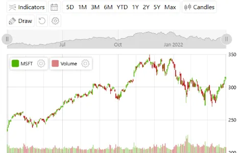
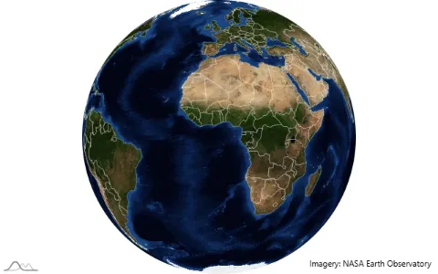
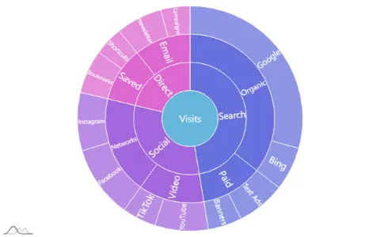
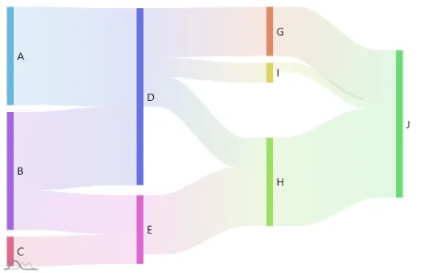
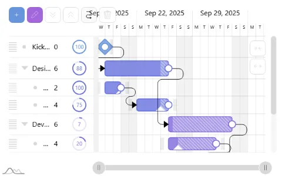
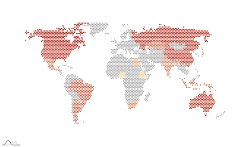
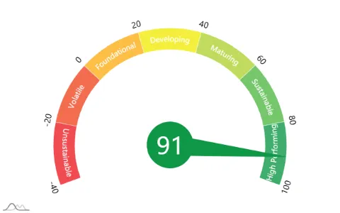
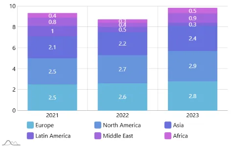

# amCharts 5

[](https://www.npmjs.com/package/@amcharts/amcharts5)
[](https://www.npmjs.com/package/@amcharts/amcharts5)

JavaScript and TypeScript charts and maps for the web: line, column, area and
candlestick charts, pies and funnels, geographic maps, stock charts, Gantt
charts, treemaps and other hierarchies, Sankey and chord diagrams, radars and
gauges, timelines, word clouds and Venn diagrams.

<p>
<a href="examples/shared/stock-chart"></a>
<a href="examples/shared/map-satellite-globe"></a>
<a href="examples/shared/hierarchy-sunburst"></a>
<a href="examples/shared/flow-sankey"></a>
<a href="examples/shared/gantt-multilevel"></a>
<a href="examples/shared/map-pixel-map"></a>
<a href="examples/shared/gauge-bands"></a>
<a href="examples/shared/xy-stacked-column"></a>
</p>

Each picture links to its example's code. About 80 examples come with the
library, and there are many more [demos](https://www.amcharts.com/demos/) on
the website.

This repository is the source code. To use amCharts 5 in a project, install the
npm package or load it with script tags, as below.

[Demos](https://www.amcharts.com/demos/) |
[Examples](examples/shared) |
[Documentation](https://www.amcharts.com/docs/v5/) |
[Class reference](https://www.amcharts.com/docs/v5/reference/) |
[Changelog](packages/shared/CHANGELOG.md) |
[Download](https://www.amcharts.com/download/)


## Highlights

* **Interactive**: zooming and panning, scrollbars, cursors, tooltips, legends,
  dragging and animations.
* **Canvas or SVG**: charts are drawn on canvas, or as SVG with
  `renderer: am5.SVGRenderer`. `am5.renderToSVG(root)` returns a chart as SVG
  markup.
* **Charts from JSON**: a chart can be described as
  [a JSON config](https://www.amcharts.com/docs/v5/concepts/serializing/) and
  built from it in code or by an `<am5-chart>` element, and a running chart can
  be saved as one.
* **Maps**: globes and flat maps (six projections built in, and any other
  d3-geo projection can be added), satellite images with day and night, pixel
  maps, lines and flows between places, and map files for the world,
  continents, countries and their regions.
* **Stock charts**: over 30 indicators, drawing tools, comparing stocks,
  period selectors, and data grouping for large data sets.
* **Export**: [images, PDF, data and printing](https://www.amcharts.com/docs/v5/concepts/exporting/):
  PNG, JPG, SVG, PDF, CSV, XLSX, JSON and HTML.
* **Themes**: [30 of them](https://www.amcharts.com/docs/v5/concepts/themes/),
  among them dark, colorblind-friendly and responsive ones.
* **Accessibility**: [keyboard navigation and screen reader support](https://www.amcharts.com/docs/v5/concepts/accessibility/).
* **TypeScript**: the library is written in it, and the type definitions come
  with the package.
* **AI coding agents**: the npm package includes `AGENTS.md` and a reference
  for every chart type, so that [agents](https://www.amcharts.com/docs/v5/ai/)
  write code for the current API.


## Install

With npm, for a project that uses a bundler:

```
npm install @amcharts/amcharts5
```

With script tags, from the CDN or from the files in the
[zip download](https://www.amcharts.com/download/):

```html
<script src="https://cdn.amcharts.com/lib/5/index.js"></script>
<script src="https://cdn.amcharts.com/lib/5/xy.js"></script>
<script src="https://cdn.amcharts.com/lib/5/themes/Animated.js"></script>
```

Maps need map files (geodata), which are a separate package:
[npm](https://www.npmjs.com/package/@amcharts/amcharts5-geodata),
[GitHub](https://github.com/amcharts/amcharts5-geodata).


## A first chart

The page needs an element with a height:

```html
<div id="chartdiv" style="width: 100%; height: 500px;"></div>
```

```js
import * as am5 from "@amcharts/amcharts5";
import * as am5xy from "@amcharts/amcharts5/xy";
import am5themes_Animated from "@amcharts/amcharts5/themes/Animated";

const root = am5.Root.new("chartdiv");

root.setThemes([
  am5themes_Animated.new(root)
]);

const chart = root.container.children.push(am5xy.XYChart.new(root, {}));

const xAxis = chart.xAxes.push(am5xy.CategoryAxis.new(root, {
  categoryField: "country",
  renderer: am5xy.AxisRendererX.new(root, {})
}));

const yAxis = chart.yAxes.push(am5xy.ValueAxis.new(root, {
  renderer: am5xy.AxisRendererY.new(root, {})
}));

const series = chart.series.push(am5xy.ColumnSeries.new(root, {
  xAxis: xAxis,
  yAxis: yAxis,
  categoryXField: "country",
  valueYField: "visits"
}));

const data = [
  { country: "France", visits: 1114 },
  { country: "Germany", visits: 1322 },
  { country: "Spain", visits: 711 },
  { country: "Italy", visits: 984 }
];

xAxis.data.setAll(data);
series.data.setAll(data);
```

With script tags the code is the same without the three `import` lines: each
file makes its module a global of the same name (`am5`, `am5xy`,
`am5themes_Animated`).

In a component (React, Angular, Vue), create the chart when the component is
mounted and call `root.dispose()` when it is removed. There are guides for
[React](https://www.amcharts.com/docs/v5/getting-started/integrations/react/),
[Angular](https://www.amcharts.com/docs/v5/getting-started/integrations/angular/),
[Vue](https://www.amcharts.com/docs/v5/getting-started/integrations/vue/),
[Next.js](https://www.amcharts.com/docs/v5/getting-started/integrations/next-js/)
and [others](https://www.amcharts.com/docs/v5/getting-started/integrations/).

The [package README](packages/shared/README.md) has the list of chart types
and their modules, where the examples are, charts from JSON, SVG, and how to
use amCharts with AI coding agents.


## What is in this repository

| Folder | What it is |
|---|---|
| `src/` | The library, in TypeScript |
| `examples/shared/` | The bundled examples, one folder each |
| `examples/thumbs/` | A picture of each example |
| `packages/shared/` | What ships beside the code: README, changelog, license |
| `packages/library/` | `AGENTS.md` and `docs/`, for AI coding agents |
| `packages/script/` | `START-HERE.html`, the first page of the zip download |
| `build/` | The build |


## Building from source

```
yarn install
```

| Command | Builds |
|---|---|
| `yarn build` | The ES modules that go to npm, into `dist/es2015` |
| `yarn build:script` | The script files that go to the zip and the CDN, into `dist/script` |
| `yarn examples` | The examples, into both of the above. Run it after `yarn build:script`, then open `dist/script/examples/index.html` |
| `yarn build:geodata` | The map files |

npm works too (`npm install`, `npm run build`), but only yarn installs the
exact versions in `yarn.lock`.


## License

If you have a commercial amCharts 5 license, this software is covered by your
license, which supersedes any other license bundled with this package.

If you don't have a commercial license, the use of this software is covered by
a freeware license. See the included [LICENSE](packages/shared/LICENSE) file.

In short: the free license allows use in any project, commercial ones
included, as long as the amCharts logo stays on the charts and the LICENSE file
stays with the files. It does not allow selling the library or distributing it
on its own. The LICENSE file has the exact terms, and
[commercial licenses](https://www.amcharts.com/online-store/) cover what it
does not.


## Support, bugs and contributing

* Found a bug, or have a question? Open an
  [issue](https://github.com/amcharts/amcharts5/issues): the amCharts team
  monitors them.
* Guaranteed support comes with the amPlus subscription. If you have a license
  or subscription, you can
  [contact us directly](https://www.amcharts.com/support/support-info/priority-support/).
  If you don't, here are
  [a few more options](https://www.amcharts.com/support/support-info/free-support/).
* A security problem: see [SECURITY.md](SECURITY.md).
* Before sending a pull request: see [CONTRIBUTING.md](CONTRIBUTING.md).
* Anything else: contact@amcharts.com.
